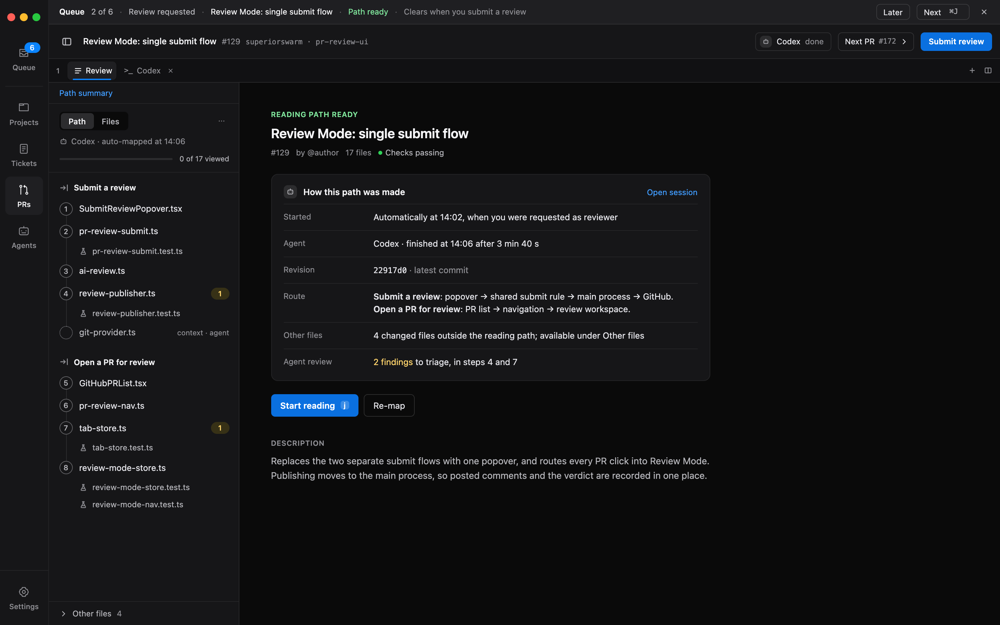
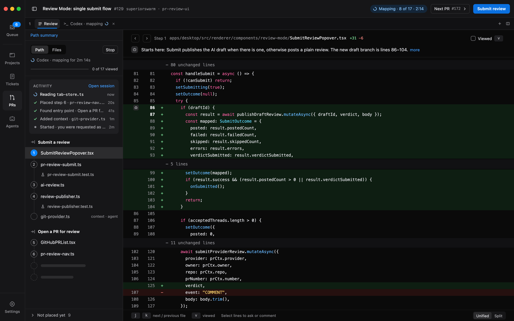
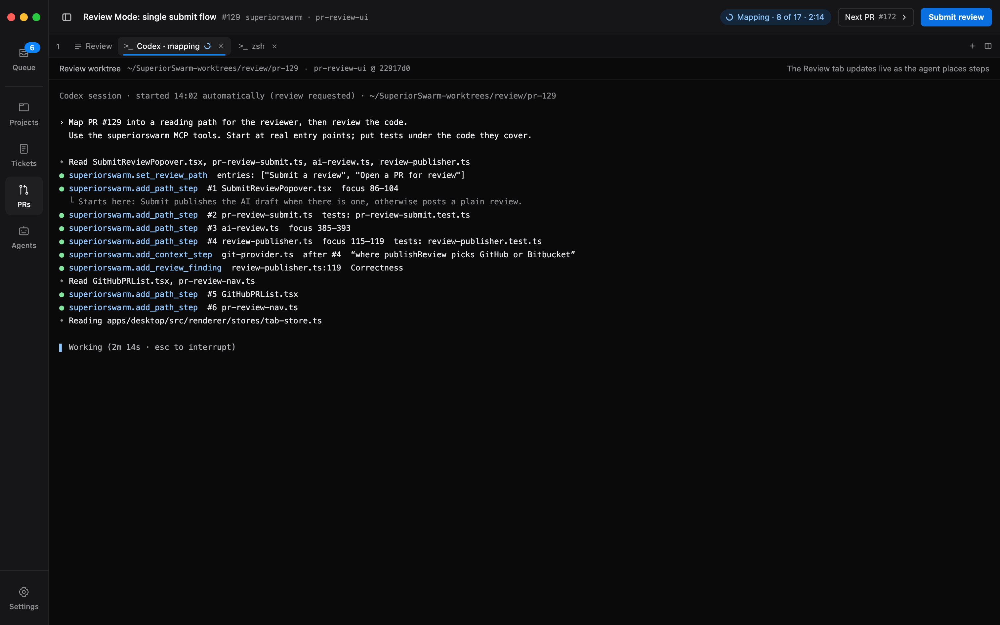
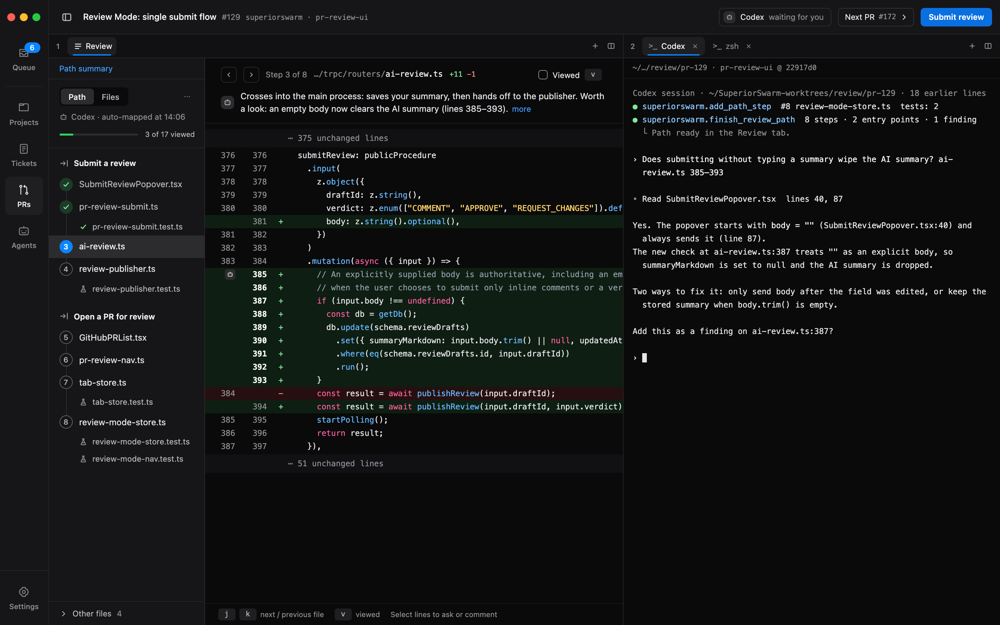
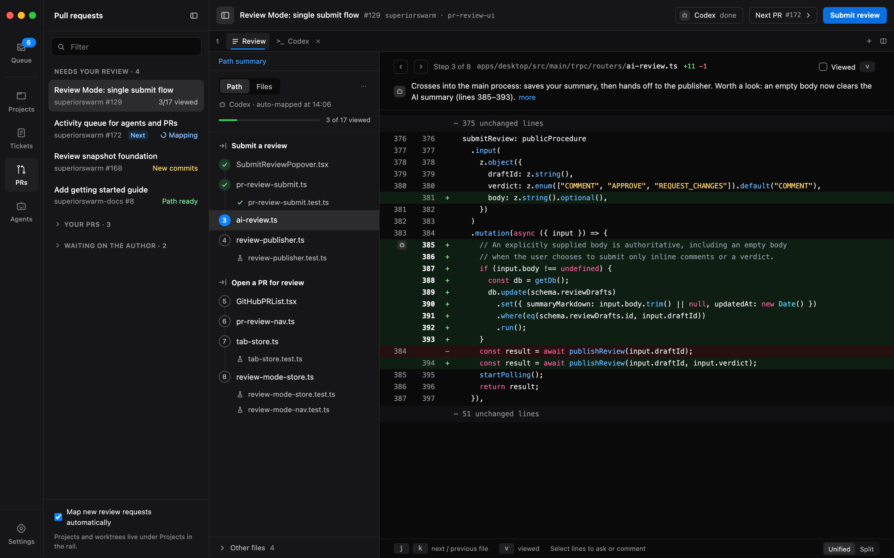
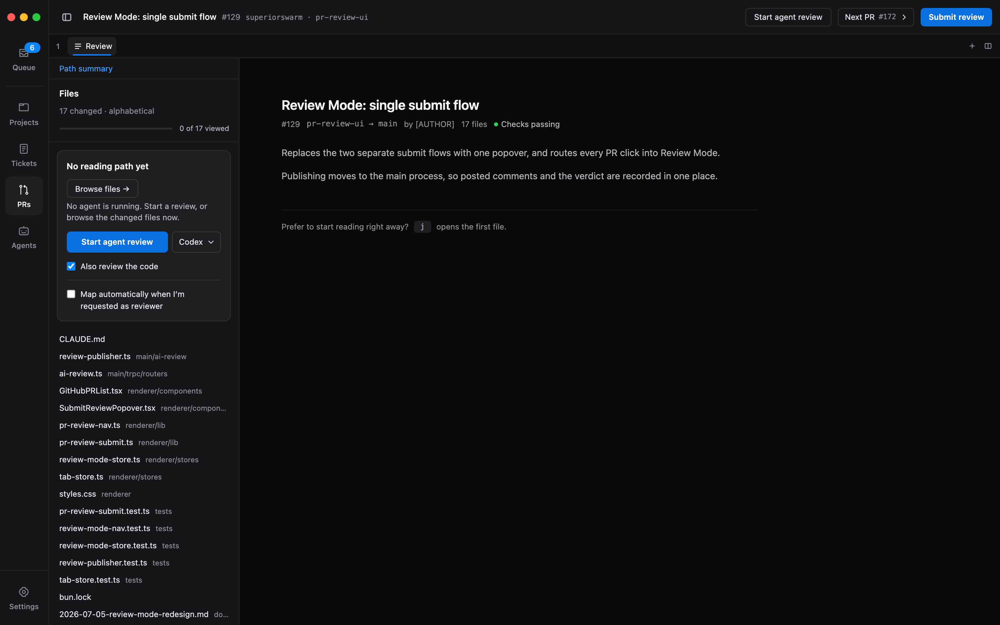

# PR review workspace: tabs, split view and app shell

Status: implemented and verified · 2026-11-22
Design canvas (original 13 boards, with accepted corrections below): https://claude.ai/artifact/Rpnes8HKKwGj7XsfXDBvyx
Corrected copies plus preparation/failure/ended lifecycle boards (16 total): `docs/superpowers/specs/assets/2026-11-22-review-pr-workspace/` (PNG at 1512×945 @2x + the HTML they were rendered from).

Source paths below are relative to `apps/desktop/src/`; `tests/` paths are relative to `apps/desktop/`. Documentation paths are repository-relative.

## 1. Read this first

**Goal.** A PR opens as a normal workspace inside the app shell. Its tab bar is the same `PaneTabBar` that every worktree uses:

- a pinned **Review** tab
- the agent's tab (**Codex**)
- any number of shells (**zsh**)

You can switch between them like terminal tabs, or split them so Review and Codex sit side by side. The NavRail stays visible the whole time. The PR list is the collapsible sidebar. Nothing takes over the window, and there is no "Back to PR review".

**How this plan relates to the other docs**

| Doc | Use it for |
| --- | --- |
| This plan | Everything the user sees: shell, PR header, tab bar, Review tab chrome, agent tab, split, PR list, status chip, keyboard, close/stop. |
| `docs/superpowers/plans/2026-11-22-pr-review-workspace-navigation-plan.md` | The agent **job** contract and backend: durable job on Start, phases, cancel, retry attempts, timing instrumentation, progressive loading, merge base. Its tasks 1, 4, 5, 6, 8 and 9 stand. Where its UI differs from this plan, this plan wins (table below). |
| `docs/superpowers/plans/2026-11-22-review-flow-recording-fixes.md` | Background: what the recording showed. Its "target design" section is replaced by this plan. |
| `docs/superpowers/specs/2026-11-21-agent-reading-path-design.md` + `plans/2026-11-21-agent-reading-path.md` | What is inside the Review tab: rail, steps, focus lines, tests, findings, threads, Ask, context steps. Unchanged except where this plan says so. |
| `activity-queue` worktree, `docs/superpowers/plans/2026-11-18-queue-redesign.md` | The 72px NavRail shell (its Task 5) and the Queue view (board 1). **Prerequisite**, see Task 0. |

**Where this plan differs from the navigation plan (follow this plan)**

| Topic | Navigation plan | This plan |
| --- | --- | --- |
| Inside the Review tab | Overview / Changes / Findings subviews | No subview switcher. The rail has a Path / Files toggle. Before you start reading, the main area shows the path summary ("How this path was made", board 2); after that it shows the step or file. Findings are inline with rail counts. The summary is always one click away: a visible **Path summary** action in the rail header. |
| Agent tab title | "Codex · Preparing / Running / Needs input" | "Codex". While busy it adds a lowercase suffix: "Codex · preparing", "Codex · mapping". Needs input and failed show a dot badge. The status chip in the PR header carries the full words. |
| Split | Implicit in "use the pane layout" | Explicit (§2.7): a Split right button in the tab bar, "Open beside Review", a 60/40 starting ratio, and a Review tab that adapts to narrow panes. |
| PR list | Sidebar PR list | Same: the PRs sidebar, toggled from the PR header. The `AllPRsDrawer` overlay is retired. |

## 2. Mocks

| # | Board | File | What it pins down |
| --- | --- | --- | --- |
| 1 | Queue: path ready in the background | [01-queue.png](../specs/assets/2026-11-22-review-pr-workspace/01-queue.png) · [html](../specs/assets/2026-11-22-review-pr-workspace/01-queue.html) | Queue view from the queue redesign. Out of scope here; it shows where "Start review" comes from. |
| 2 | Opened from the queue: how this path was made | [02-landing.png](../specs/assets/2026-11-22-review-pr-workspace/02-landing.png) · [html](../specs/assets/2026-11-22-review-pr-workspace/02-landing.html) | Review tab landing summary, PR header, tab bar with Review + Codex. |
| 3 | Still mapping: live activity | [03-mapping.png](../specs/assets/2026-11-22-review-pr-workspace/03-mapping.png) · [html](../specs/assets/2026-11-22-review-pr-workspace/03-mapping.html) | Status chip "Mapping · 8 of 17 · 2:14", Codex tab with spinner, rail activity log. |
| 4 | Codex tab: the agent's session | [04-codex-tab.png](../specs/assets/2026-11-22-review-pr-workspace/04-codex-tab.png) · [html](../specs/assets/2026-11-22-review-pr-workspace/04-codex-tab.html) | Agent tab selected: worktree line + terminal. zsh is a sibling tab. |
| 5 | **Split: Review next to Codex** | [05-split.png](../specs/assets/2026-11-22-review-pr-workspace/05-split.png) · [html](../specs/assets/2026-11-22-review-pr-workspace/05-split.html) | Two panes, each with its own tab bar. The PR header spans both. Narrow Review layout (rail 236px). |
| 6 | PR list open | [06-pr-list.png](../specs/assets/2026-11-22-review-pr-workspace/06-pr-list.png) · [html](../specs/assets/2026-11-22-review-pr-workspace/06-pr-list.html) | PRs sidebar opened from the header's list button; review keeps its place. |
| 7 | Reading a step | [07-reading.png](../specs/assets/2026-11-22-review-pr-workspace/07-reading.png) · [html](../specs/assets/2026-11-22-review-pr-workspace/07-reading.html) | Default reading layout under the tab bar. |
| 8 | Files view | [08-files.png](../specs/assets/2026-11-22-review-pr-workspace/08-files.png) · [html](../specs/assets/2026-11-22-review-pr-workspace/08-files.html) | Rail in Files mode. |
| 9 | More context | [09-context.png](../specs/assets/2026-11-22-review-pr-workspace/09-context.png) · [html](../specs/assets/2026-11-22-review-pr-workspace/09-context.html) | Context steps. |
| 10 | No path yet | [10-no-path.png](../specs/assets/2026-11-22-review-pr-workspace/10-no-path.png) · [html](../specs/assets/2026-11-22-review-pr-workspace/10-no-path.html) | No agent run: chip "Codex idle", Map card in the rail. |
| 11 | Ask and comment | [11-ask.png](../specs/assets/2026-11-22-review-pr-workspace/11-ask.png) · [html](../specs/assets/2026-11-22-review-pr-workspace/11-ask.html) | Ask panel sits inside the Review tab, below the tab bar. |
| 12 | Agent findings | [12-findings.png](../specs/assets/2026-11-22-review-pr-workspace/12-findings.png) · [html](../specs/assets/2026-11-22-review-pr-workspace/12-findings.html) | Inline findings. |
| 13 | Comments from other reviewers | [13-threads.png](../specs/assets/2026-11-22-review-pr-workspace/13-threads.png) · [html](../specs/assets/2026-11-22-review-pr-workspace/13-threads.html) | Threads panel inside the Review tab. |

Additional lifecycle boards: [14 Preparing](../specs/assets/2026-11-22-review-pr-workspace/14-preparing.png) · [HTML](../specs/assets/2026-11-22-review-pr-workspace/14-preparing.html), [15 Failed](../specs/assets/2026-11-22-review-pr-workspace/15-failed.png) · [HTML](../specs/assets/2026-11-22-review-pr-workspace/15-failed.html), [16 Ended](../specs/assets/2026-11-22-review-pr-workspace/16-ended.png) · [HTML](../specs/assets/2026-11-22-review-pr-workspace/16-ended.html).

### Boards this plan builds

**2 · Landing** — Review tab, summary before reading



**3 · Mapping** — chip, spinner on the Codex tab, live activity in the rail



**4 · Codex tab** — the agent's tab selected



**5 · Split** — Review (pane 1) next to Codex + zsh (pane 2)



**6 · PR list** — sidebar opened from the header



**10 · No path yet** — no run, Map card in the rail



Boards 7–9 and 11–13 need no content change; they only gain the shell and tab bar. Boards 2–6 and 10 are what this plan builds. Mock text (findings, agent output, handles) is illustrative. One exception: the Codex answer in board 5 describes real code: `SubmitReviewPopover.tsx` starts `body` as `""` (line 40) and always sends it (line 87), and the new check at `ai-review.ts:334–337` then stores a null summary.

## 3. Target behaviour

### 3.1 Shell (all boards)

- NavRail (72px) is always visible on the left: Queue · Projects · Tickets · PRs · Agents · Settings.
- Next to it is the app sidebar. In the PRs segment it is the PR list. It collapses to 0px.
- The main area holds the PR workspace: PR header on top, then the pane layout.
- `App.tsx` must no longer swap the whole window for the review (the `showReviewWorkspace` branch).

### 3.2 PR header (one per PR workspace, spans all panes)

- Height 52px, `--bg-surface`, bottom border `--border-subtle`. Left to right:
  1. **PR list toggle** (sidebar icon, 30×30). It toggles the sidebar (`app:toggle-sidebar`). `aria-expanded` reflects the sidebar state.
  2. Title (13px/500), `#number` (12px, `--text-tertiary`), `repo · branch` (11px mono, `--text-tertiary`). Clicking the title opens the path summary. It is not the only way to get there.
  3. Spacer.
  4. Existing ↻ refresh button (kept; not drawn in the mocks).
  5. **Agent status chip** (§3.8).
  6. **Next PR #n** (outlined button).
  7. **Submit review** (primary, `--accent`). It keeps `SubmitReviewPopover` and its existing rules.
- Removed:
  - the "All PRs" button (the list is the sidebar)
  - the "Agent workspace" button
  - the `pl-[88px]` traffic-light padding (the NavRail owns the traffic lights)

### 3.3 Tab bar

- This is the existing `PaneTabBar`: 36px, `--bg-tab-bar`, pane index column, 28px pills, active pill on `--tab-active-bg` with a 2px `--accent` underline, separators between inactive pills, "+" on the right. Changes:
  - **Pinned tabs.** The Review tab has no close button and no "Close" in its context menu. It can be dragged between panes of the same workspace, but never closed or moved out of the workspace.
  - **Icons.** Review uses the existing three-line `review` icon. Agent and shell tabs use `>_`.
  - **Agent badges.**
    - Spinner (11px, `--accent`) while preparing/mapping.
    - 6px `--tag-amber-fg` dot for needs input. Show it only when the job reports a supported needs-input signal, never on silence.
    - 6px `--color-danger` dot for failed.
  - **Split right button** (24×24, after "+"), in every workspace. It moves the active tab into a new pane on the right. Automatic splitting keeps Review in place: when Review is active, the most recently active other tab moves instead. With nothing to move, the new pane is empty (today's behaviour).
  - **"+" in a PR workspace** opens a shell in the review worktree, titled "zsh" (shell basename). While the workspace has no isolated worktree (the logical browsing record whose cwd is the project root), "+" is disabled with the tooltip "Terminals open in the review worktree. It's created when an agent starts." Never open a shell in the fallback project root from here.
- Existing shortcuts must work unchanged inside a PR workspace:
  - ⌘\ split right, ⌘⇧\ split down
  - ⌘⇧] / ⌘⇧[ next/previous tab
  - ⌘⌥←/→ focus pane
  - ⌘⇧W close pane (closing a pane that holds Review moves Review into the remaining pane instead of closing it)

### 3.4 Review tab

- Content: today's `ReviewWorkspace`, minus its top bar and minus `ReviewWorkflowBar`. Rail, reading pane, side panel (Threads / Ask) and hint bar all stay inside the tab.
- It is mounted once and stays mounted while hidden, like terminals: switching to Codex and back must not reload the diff or lose scroll, selection, open thread or draft text.
- Landing (board 2): when no step or file is selected, the main area shows the path summary card "How this path was made". Rows:
  - Started (auto/manual + time)
  - Agent (+ finished after …)
  - Revision (short SHA + "latest commit" / "older commit")
  - Route (one line per entry point)
  - Other changed files (count from `otherFiles`; reasons only when recorded, never inferred)
  - Agent review (findings count + steps)

  Below the card: "Start reading" and "Re-map", then the PR description. "Open session" in the card selects the agent tab.
- Mapping (board 3): the rail shows the live activity list and placed steps; unplaced slots show skeleton rows; the rail header shows "Stop". The diff of the first placed step is readable meanwhile.
- No run (board 10): the rail shows the existing `MapPathCard`; the chip says "Codex idle".
- Narrow pane (container width, not window width; use a `ResizeObserver` on the tab root):
  - below 960px: the rail is 236px, the step header shortens the directory to `…/last-dir/`, the Unified/Split diff toggle hides, and the hint bar shows only j/k/v and "Select lines to ask or comment"
  - below 720px: the rail collapses to the existing collapsed navigator, with its toggle

### 3.5 Agent tab

- One agent tab per review job. It appears the moment Start is accepted, before any PTY exists, without taking focus. It is added after Review in the same pane, inactive.
- Its content follows the job state:

| Job state | Tab title / badge | Content |
| --- | --- | --- |
| queued / preparing phases | "Codex · preparing", spinner | Phase list with the current phase, phase elapsed time, last update, **Cancel** (navigation plan task 6). |
| session open, mapping | "Codex · mapping", spinner | Worktree line (`Review worktree ~/…/pr-129 · branch @ sha`, 32px, 12px `--text-tertiary`) + the terminal (`ReviewAgentTerminal`). |
| session open, idle / answering | "Codex" | Same as above. |
| needs input (supported signal only) | "Codex", amber dot | Same; the terminal shows the prompt. |
| failed | "Codex", red dot | Failed phase + short reason inline, **Retry** (new attempt in the same tab) and **Show log**. |
| ended (PTY gone) | "Codex" | Summary + links "Open reading path" / "Review findings" (select the Review tab and navigate). Never relaunch on mount. |

- Board 4 shows the session state. Today's inner "Codex · mapping path / zsh" strip inside the terminal view is gone: zsh is its own tab.

### 3.6 Shells

- Shells are ordinary `terminal` tabs in the review worktree, created with "+".
- Closing one disposes it, as everywhere else.

### 3.7 Split view (board 5)

- Any tab can go in any pane. The PR header spans the full width above all panes.
- Ways to get Review and Codex side by side:
  - drag a tab to a pane edge (existing `DropZoneOverlay`)
  - the Split right button (§3.3) while Review is active
  - ⌘\ (same rule as the button)
  - the agent tab's context menu "Open beside Review"
  - ⌥-click on the status chip
- When the split is created by "Open beside Review", the button or ⌥-click, Review stays left with ratio 0.6. Drag-created splits keep today's 0.5.
- Each pane has its own tab bar and its own active tab. Focus follows click (existing `setFocusedPane`).
- Layout is per PR workspace and persists like any workspace layout (hydrate/serialize). Reopening the PR restores the split.

### 3.8 Agent status chip

One component replaces today's `AgentStatusChip` + `MappingPill`. It sits in the PR header and always says what the agent is doing. Click selects the agent tab: it switches tabs if the agent shares the focused pane, otherwise it focuses that pane. ⌥-click opens it beside Review. With no job, click starts the setup the `MapPathCard` offers.

| State | Chip | Example board |
| --- | --- | --- |
| no job | "Start agent" setup action; no agent tab before acceptance | 10 |
| preparing | spinner · "Preparing · 0:42" (tooltip: current phase) | — |
| mapping | spinner pill (`--accent` tint) · "Mapping · 8 of 17 · 2:14" | 3, 4 |
| needs input | amber dot · "Codex" · "waiting for you" | 5 |
| failed | red dot · "Codex" · "didn't start" / "stopped" | — |
| done | agent glyph · "Codex" · "done" | 2, 6–9, 11–13 when mapping completed |

Counts only appear when measured (`progress.placed/total`). Elapsed time ticks every second while visible.

### 3.9 Keyboard scope

- Review shortcuts (j/k, v, c, n/p, Esc and the rest of `useReviewKeymap`) fire only when the Review tab is the active tab of the focused pane and the event target is inside `[data-review-workspace]`, or the body.
- Typing in any terminal never triggers them.
- Esc in Review no longer "returns from terminal". The `view === "terminal"` branch goes away.

### 3.10 Close vs stop

- Closing the **agent tab** hides it. Job and PTY keep running.
  - Reopen it from the status chip or a running-job badge.
  - `pane-lifecycle.ts` must not dispose review-path terminals or agent-job tabs on close. It disposes them only on explicit Stop or when the workspace is removed.
- **Stop agent** cancels the job. It lives in the agent tab's context menu and on the agent tab's failed/running content.
- Closing the PR workspace and stopping a job are separate actions (navigation plan).

### 3.11 Loading

- PR switch keeps the shell, header and tab bar.
- The Review tab shows skeletons for the rail and diff, never a blank "Loading review…" full screen. Progressive loading itself is navigation plan task 8.

## 4. Architecture

### 4.1 Tab kinds (`renderer/stores/tab-store.ts`)

Add two kinds to `TabItem`:

```ts
| {
    kind: "pr-review";
    id: string;            // `pr-review:${workspaceId}` — exactly one per PR workspace
    workspaceId: string;
    prCtx: PRContext;
    title: "Review";
  }
| {
    kind: "review-agent";
    id: string;            // `review-agent:${jobId}`; durable job ID only
    workspaceId: string;
    jobId: string;
    agentLabel: string;    // "Codex" | "Claude Code"
    terminalId?: string;   // set once the owned PTY is registered (`review-path:*`)
    cwd?: string;          // review worktree, once known
    title: string;         // derived, see §3.5
  }
```

- `isPinnedTab(tab) = tab.kind === "pr-review"`. Use it in `PaneTabBar`, `PaneContextMenu`, `pane-lifecycle.ts`, `pane-store.closePane` (re-home Review instead of dropping it) and the split rules.
- `review-agent` replaces using a bare `terminal` tab with a `review-path:*` id for the agent. `isReviewPathTerminal` stays as the guard for the PTY itself.
- Coordinate with navigation plan task 5. It is the same tab; define it once.

### 4.2 Opening a PR

- `activateReviewWorkspace()` (tab-store) → `usePaneStore.ensureLayout(workspaceId)` → `ensureReviewTab(workspaceId, prCtx)`.
- `ensureReviewTab` inserts the `pr-review` tab at index 0 of the first pane if the layout has none. If the user moved it, leave it where it is. Make it active only when the layout was just created.
- An existing agent job for this PR → `ensureReviewAgentTab(job)`, same rules: idempotent, never focus-stealing.

### 4.3 Job state for the UI

- Add `useReviewAgentJob(workspaceId, prCtx)` returning:

  ```ts
  { state, phase?, phaseStartedAt?, progress?, agentLabel, terminalId?, error?, cancel(), retry(), stop() }
  ```

  - Implement the durable job contract before agent-tab integration. Never substitute a run ID for a stable job ID. Reads, hydration and opening tabs never launch work.
  - Afterwards, read the durable job query.
- The chip, the agent tab and the landing card all read this one hook.

### 4.4 Render tree

```
App
└─ NavRail · Sidebar(PRs list, collapsible) · Main
   └─ MainContentArea
      └─ PRReviewWorkspace            (new; when segment = prs and active review = active workspace)
         ├─ PRReviewHeader            (from top-bar/ReviewTopBar.tsx)
         └─ LayoutRenderer(layout)     (existing)
            └─ PaneContainer → PaneTabBar + PaneContent
               ├─ pr-review     → ReviewTabContent (ReviewWorkspace minus top bar/workflow bar), always mounted
               ├─ review-agent  → ReviewAgentTab (phases | ReviewAgentTerminal | failed | ended)
               └─ terminal      → Terminal (existing)
```

### 4.5 Delete or retire

- `review-mode/ReviewAgentWorkspace.tsx`
- the `reviewTabsOpen` branch in `MainContentArea.tsx`
- the `showReviewWorkspace` full-window branch in `App.tsx`
- `ReviewView "terminal"` and every `setView("terminal")`
- `lib/review-terminal-tab.ts`, replaced by `revealReviewAgentTab(workspaceId, { beside?: boolean })`
- `top-bar/MappingPill.tsx`, merged into the chip
- `queue/AllPRsDrawer.tsx`, replaced by the PRs sidebar
- `ReviewWorkflowBar.tsx` (navigation plan task 10). Its roles move to the chip, `MapPathCard`, the landing card and the agent tab.
- Check `ReviewModeShell.tsx`'s `ActiveReviewModeShell`, `TerminalDrawer.tsx` and `ReviewHeader.tsx`: remove any that are unused once the above is done.

## 5. Tasks

Write the listed tests first. Run focused suites per directory (see CLAUDE.md: the full suite is flaky locally). Keep Biome clean.

### Task 0 — Base on the NavRail shell

- **Do:** Rebase this branch onto the `activity-queue` work that adds `components/NavRail.tsx` and `components/MainLayout.tsx` (queue redesign Task 5), or wait until it is on main.
- **If that's not possible yet:** do Tasks 1–7 against today's `Sidebar`. The rule is the same: the review renders inside the normal layout, never as a full-window replacement.
- **Done when:** the branch has NavRail + collapsible sidebar, and focused checks introduce no new type diagnostics against the recorded pre-existing main/renderer baseline. Record unrelated failures separately.

### Task 1 — Tab model: `pr-review`, `review-agent`, pinned tabs

- **Files:**
  - `renderer/stores/tab-store.ts`
  - `renderer/stores/pane-store.ts`
  - `shared/pane-types.ts` (types only if needed)
  - `renderer/lib/pane-lifecycle.ts`
  - tab persistence/hydration code paths that switch on `kind`
- **Tests first:**
  - `tests/tab-store.test.ts`:
    - `ensureReviewTab` is idempotent
    - a moved Review tab is not re-inserted
    - hydrate keeps `pr-review` / `review-agent`
  - `tests/pane-store.test.ts`:
    - `closePane` on the pane holding Review moves Review to the sibling
    - `splitPane` never moves a pinned tab
  - `tests/pane-lifecycle.test.ts`:
    - closing a `review-agent` tab or a `review-path:*` terminal does **not** call `terminal.dispose`
    - closing a normal terminal still does
- **Done when:** the kinds exist, `isPinnedTab` is used by all four call sites, and the tests pass.

### Task 2 — Render the PR as a workspace inside the shell

- **Files:**
  - `renderer/App.tsx`
  - `renderer/components/MainContentArea.tsx`
  - new `renderer/components/review-mode/PRReviewWorkspace.tsx`
  - `renderer/components/panes/PaneContent.tsx`
  - `review-mode/ReviewWorkspace.tsx` (split into `ReviewTabContent` without top bar / workflow bar)
  - `renderer/stores/review-mode-store.ts` (remove `"terminal"` view)
  - delete `ReviewAgentWorkspace.tsx`
- **PaneContent:** render `pr-review` tabs always mounted with `visible/invisible`, like terminal tabs. Render `review-agent` the same way once it has a `terminalId`.
- **Tests first:**
  - update `tests/review-terminal-navigation.test.tsx` and `tests/review-workspace.test.tsx`
  - new `tests/pr-review-workspace-shell.test.tsx`:
    - opening a PR keeps NavRail, sidebar and tab bar
    - Review → agent tab → Review keeps the selected file, scroll offset and an unsent comment draft
    - no element with "Back to PR review"
- **Done when:** the review renders inside the shell for every board, and no code path renders `ReviewAgentWorkspace`.

### Task 3 — PR header

- **Files:**
  - `review-mode/top-bar/ReviewTopBar.tsx` → `PRReviewHeader` (or rename in place)
  - `review-mode/ReviewWorkspaceTopBar.tsx` (move its submit wiring into the header)
- **Do:** implement §3.2.
- **Tests first:**
  - header renders list toggle, title, chip, Next PR, Submit
  - list toggle dispatches `app:toggle-sidebar` and mirrors `aria-expanded`
  - no "All PRs" / "Agent workspace" buttons
- **Done when:** it matches boards 2–13 at 1512×945.

### Task 4 — Tab bar changes

- **Files:**
  - `renderer/components/panes/PaneTabBar.tsx`
  - `renderer/components/panes/PaneContextMenu.tsx`
  - `renderer/actions/core-actions.ts` (`pane.splitRight` / `pane.splitDown` follow the pinned rule)
- **Do:** implement §3.3:
  - pinned (no close)
  - icons and agent badges
  - Split right button
  - context menu items for agent tabs: "Open beside Review", "Stop agent"
  - "+" disabled without an isolated worktree
- **Tests first:**
  - new `tests/pane-tab-bar.test.tsx`:
    - Review has no close button
    - split while Review is active moves the last-active other tab
    - "+" is disabled when the workspace cwd is the project fallback
    - the badge renders for each job state
- **Done when:** the tab bar matches boards 2, 4 and 5.

### Task 5 — Agent tab

- **Files:**
  - new `review-mode/ReviewAgentTab.tsx`
  - new `review-mode/hooks/useReviewAgentJob.ts`
  - `review-mode/ReviewAgentTerminal.tsx`
  - `renderer/lib/review-connected-terminal.ts` (register into the `review-agent` tab instead of `review-mode-store.terminals` + a later `addTerminalTab`)
  - `review-mode/hooks/useReviewConnections.ts`
- **Do:** implement §3.5.
  - Create the tab when Start is accepted, today in `useReviewConnections` / the start mutation's accept point.
  - Attach `terminalId` when `attachReadingPathTerminal` succeeds.
  - Keep all existing scope/ownership checks (`reviewScopeKey`, `review-path:` prefix, cwd match).
- **Tests first:**
  - extend `tests/review-agent-terminal.test.tsx`, `tests/review-terminal-state.test.ts`, `tests/review-terminal-tab.test.ts`:
    - tab exists during preparing, without a PTY
    - Start A → switch to PR B → late attach for A lands in A's workspace and does not take focus
    - failed → Retry stays in the same tab
    - ended → summary, no relaunch on remount
    - close → reopen from the chip shows the same live terminal
- **Done when:** the recording's "Open agent workspace" step is no longer needed anywhere.

### Task 6 — Agent status chip

- **Files:**
  - `review-mode/AgentStatusChip.tsx` (rewrite)
  - delete `top-bar/MappingPill.tsx`
  - the header from Task 3
- **Do:** implement §3.8, including ⌥-click "beside", via `revealReviewAgentTab(workspaceId, { beside })`.
- **Tests first:**
  - each state's label
  - elapsed time format `m:ss`
  - click selects the agent tab in the correct pane
  - ⌥-click creates a 0.6 split with Review left
- **Done when:** it matches boards 2, 3 and 5.

### Task 7 — Split view and the responsive Review tab

- **Files:**
  - `renderer/stores/pane-store.ts` (`splitPane` accepts an optional ratio)
  - `review-mode/ReviewWorkspace.tsx` / `ReviewTabContent`
  - `review-mode/rail/ReviewRail.tsx`
  - `review-mode/step/StepHeader.tsx`
  - `review-mode/HintBar.tsx`
  - `review-mode/hooks/useReviewKeymap.ts`
- **Do:** implement §3.7 and §3.9. For the keymap:
  - Keep `isReviewEditableTarget`.
  - Add a check that the Review tab is the active tab of the focused pane: read `usePaneStore` focused pane + active tab id.
  - The check also requires the event target to be inside `[data-review-workspace]` or `document.body`.
- **Tests first:**
  - new `tests/review-split.test.tsx`:
    - rail width is 236px when the container is 868px wide
    - Unified/Split toggle hidden below 960px
    - the split persists across hydrate
  - `tests/review-keymap.test.ts`: "j" typed in a terminal pane (focused) does not advance the file; "j" with Review focused does
- **Done when:** board 5 is reproducible from board 7 with one click on Split right, and ⌘⇧] cycles tabs in the focused pane.

### Task 8 — PR list as the sidebar

- **Files:**
  - `renderer/components/PullRequestsTab.tsx`
  - `review-mode/queue/useReviewQueue.ts`
  - `review-mode/queue/PRQueueRow.tsx`
  - delete `queue/AllPRsDrawer.tsx` and the `queueOpen` state in `review-mode-store.ts`
- **Do:** match board 6.
  - Sections: "Needs your review · n" open, "Your PRs · n" and "Waiting on the author · n" collapsed, plus a filter field.
  - Rows show title, `repo #n`, viewed x/y, and a status tag ("Next", "Mapping", "New commits", "Path ready").
  - Footer: the "Map new review requests automatically" checkbox (`autoMapOnReviewRequest` in `renderer/stores/review-path-settings-store.ts`) and the hint "Projects and worktrees live under Projects in the rail."
  - Opening another PR from the list switches workspace. The current PR's layout and Review state are kept (they live in its workspace).
- **Tests first:**
  - list groups match `useReviewQueue`
  - selecting a row opens that PR and keeps the sidebar open
  - the previous PR's Review tab state is restored when you come back
- **Done when:** nothing opens the old drawer, and Next PR still works.

### Task 9 — Review tab content: landing, mapping, no-path; retire the workflow band

- **Files:**
  - `review-mode/ReviewReadingPane.tsx` (landing when no selection)
  - new `review-mode/views/PathSummaryCard.tsx`
  - `review-mode/rail/RailHeader.tsx` (provenance line opens the summary; "Stop" while mapping)
  - `review-mode/rail/MapPathCard.tsx`
  - `review-mode/ReviewWorkflowBar.tsx` (delete)
  - `shared/review-path-runtime.ts` (add `trigger: "auto" | "manual"`, `startedAt`, `endedAt` to `ReviewPathRun` unless the durable job from navigation plan task 4 already provides them)
- **Persistence:** review runs and jobs live inside the versioned JSON `review_path_documents.payload`. Extend and normalize this payload; do not invent SQL run columns. Legacy unknown timestamps stay null.
- **Do:** implement §3.4 landing / mapping / no-run.
  - Every message the workflow band showed must have a new home: chip, agent tab, Map card, or summary card. Make a checklist from `ReviewWorkflowBar.tsx` (e.g. "PR changed since this review" → summary card revision row + chip; "Agent did not start" → agent tab failed state + chip).
- **Tests first:**
  - update `tests/review-workflow-bar.test.tsx` into `tests/review-path-summary.test.tsx`: each row renders from fixture data; unknown values render "—", not invented
  - mapping shows skeleton rows for unplaced steps
  - no-run shows `MapPathCard`
- **Done when:** boards 2, 3 and 10 match, and the 140px band is gone.

### Task 10 — Verify against the mocks and replay the recording

- Native/Electron check at 1512×945 (`tests/review-workspace-native.test.ts` or a new fixture): screenshot boards 2, 3, 4, 5, 6, 7 and 10 states and compare them side by side with the PNGs in `docs/superpowers/specs/assets/2026-11-22-review-pr-workspace/`. Differences must be intentional and noted in the PR.
- Run the acceptance list below by hand on a real PR (GitHub and Bitbucket).

## 6. Acceptance (replay of the recording)

1. Open a PR from the queue or the PR list. NavRail, sidebar toggle, PR header and tab bar are visible at once. There is no full-window transition and no blank "Loading review…" screen.
2. The Review tab is pinned: no close button. Drag it to another pane and it still works.
3. Start the agent. A "Codex · preparing" tab appears next to Review without taking focus, and the chip shows the phase and elapsed time. Cancel works during preparation.
4. While mapping, the chip reads "Mapping · n of m · m:ss", the Codex tab shows a spinner, and Review stays usable.
5. Click Split right with Review active. Codex opens on the right at 60/40. Each pane switches tabs on its own. ⌘⇧] / ⌘⇧[ cycle tabs in the focused pane.
6. Type in the Codex terminal. No review shortcut fires. Click the diff and press j: the next file opens.
7. Close the Codex tab. The agent keeps running. Click the chip: the same session is back, scrollback intact. "Stop agent" ends it.
8. Press "+". A zsh tab opens in the review worktree. Before a worktree exists, "+" is disabled with the tooltip.
9. Open the PR list from the header, switch to another PR, then come back. The split, active tabs, selected file and scroll position are as you left them.
10. Fail preparation (fixture). The Codex tab shows the failed phase and reason with Retry. Retry keeps the same tab.
11. After the agent ends, the Codex tab shows the summary with links. Reopening the PR never relaunches it.
12. At 1512×945 every board in §2 matches its mock within normal implementation tolerance.

## 7. Out of scope

- The Queue view itself (board 1) and ⌘J: queue redesign plan.
- Job persistence, phases, cancellation internals, timing instrumentation, provider loading and the merge-base fix: navigation plan tasks 1, 4, 6, 8 and 9. This plan consumes them through `useReviewAgentJob`.
- Content inside the Review tab (rail rows, focus lines, threads, Ask, findings, context steps): the 2026-11-21 spec and plan.

## Accepted review corrections and integration gates (2026-11-22)

These corrections supersede inconsistent illustrative labels in the original boards.

1. Accept a durable, idempotent job before metadata, fetch, checkout or PTY launch. Stable job ID; each retry has a fresh attempt and fenced run authority. Persist phase/activity/elapsed timestamps and cancellation during preparation. A delayed result cannot revive a cancelled attempt.
2. Preserve per-workspace/PR/revision selection, drafts, scroll and panel state across PR changes and pane reparenting. Retained mounting alone is insufficient. Hidden Review panes suspend keyboard and expensive presentation work.
3. Guard ordinary shells at all renderer entry points and the main terminal IPC boundary. A logical PR workspace cannot fall back to the project's root. Only a verified isolated review worktree enables shells.
4. A completed mapping cannot accept writes. Ask accepts an independent scoped question job/attempt; its tab reflects that job. Opening or restoring an ended tab never restarts it. Closing hides a job; Stop cancels it.
5. Always expose Path summary, Browse changed files, Ask and Threads. A mapping with zero placed steps must keep known files available. Findings entries navigate to their location.
6. Below 960px container width, actually render unified diffs without changing the saved split preference. Below 720px collapse the navigator. Panels fit the container and remain operable with sidebar + split + Ask.
7. Completed paths say done, not idle. Board 10 has only Review until a job is accepted. Preparing, failed, cancelled and completed are explicit lifecycle states. Needs-input is shown only from supported runtime evidence.
8. Use real job timestamps/activity and explicit unknown provenance for legacy data. Normalize old review-path terminal tabs conservatively without spawning. Your PRs uses an authored-PR source distinct from review requests; preserve provider capabilities, especially unsupported Bitbucket viewed counts.
9. Manual dragging may move Review within its workspace. Automatic split keeps Review left at 60%; manual edge split remains 50%. Closing its pane rehomes Review. Preserve the final Review pane.

### Acceptance evidence

- PR browse remains independent of Git fetch/worktree preparation; cold metadata failures cannot block shell navigation.
- Start acknowledgment is tested while metadata/fetch promises are held; cancellation prevents late launches.
- Exact head and verified merge-base define agent diff scope; target branch tip is separately named.
- Repeated tab/PR switches do not refetch an unchanged diff or lose drafts.
- Native 1512×945 review and narrow split views are checked along with agent preparation/failure/end UI.
- Full type-check baseline failures are reported honestly; changed-file diagnostics must be resolved.

### Execution ownership

| Lane | Owner | Scope |
| --- | --- | --- |
| Durable jobs | workspace_jobs | Acceptance, attempts, preparation, cancellation, exact diff scope, IPC shell guard |
| Tabs/panes | workspace_tabs | Tab kinds, pins, split/rehome, migration, shell controls |
| Reading content | workspace_review_content | Scoped state, summary, responsive diff/panels, keyboard |
| Integration | root | App shell, PR header/sidebar, job observation/transport, agent content, boards and final checks |

## Integration outcome

The PR workspace is implemented in the existing app shell using normal pane tabs. The `activity-queue` branch's 72px navigation geometry/icons were integrated for routes available on this branch. Its independently owned Queue feature (board 1) was not merged wholesale; that feature remains outside this PR implementation, as permitted by Task 0's fallback. No placeholder Queue destination was added.

The original design remarks are addressed by durable jobs and preparation/cancel/retry UI, per-PR persisted state, strict shell/terminal ownership, scoped Ask attempts, visible navigation actions, responsive diff/panels, corrected lifecycle boards, honest unknown/provenance states, and tested pin/split/restore behavior.

Native evidence uses disposable Git repositories and profiles, real Monaco and production snapshot IPC. It does not contact providers, launch paid agents, or publish reviews. Real provider/CLI response latency remains dependent on the connection; navigation and early job acceptance no longer wait for agent preparation.

Detailed checks and remaining baseline constraints: [implementation verification](2026-11-22-review-pr-workspace-tabs-verification.md).
