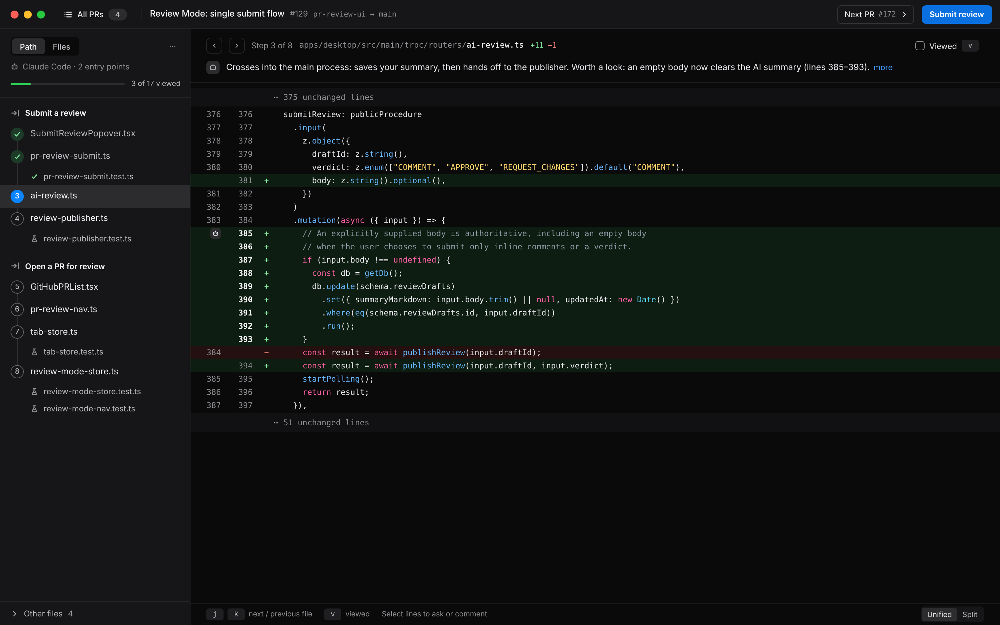
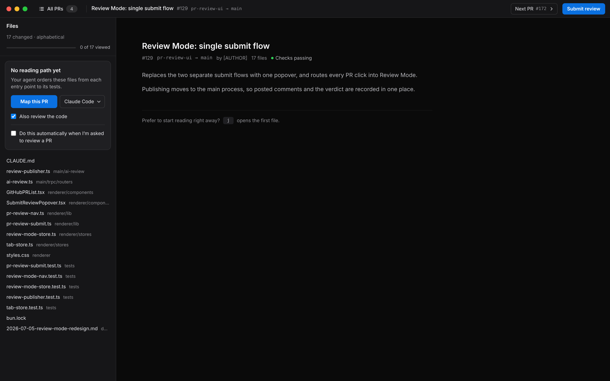
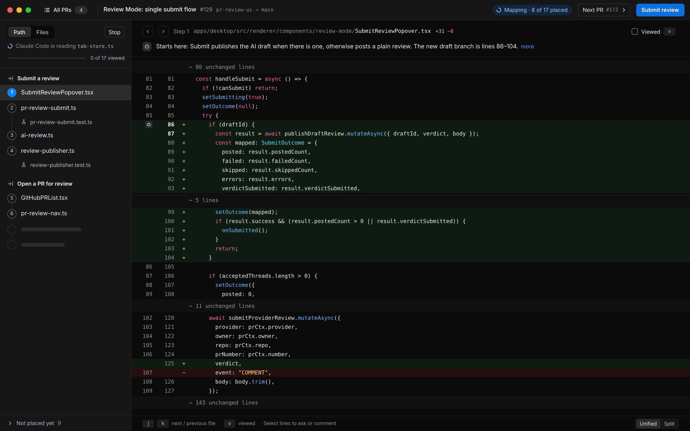
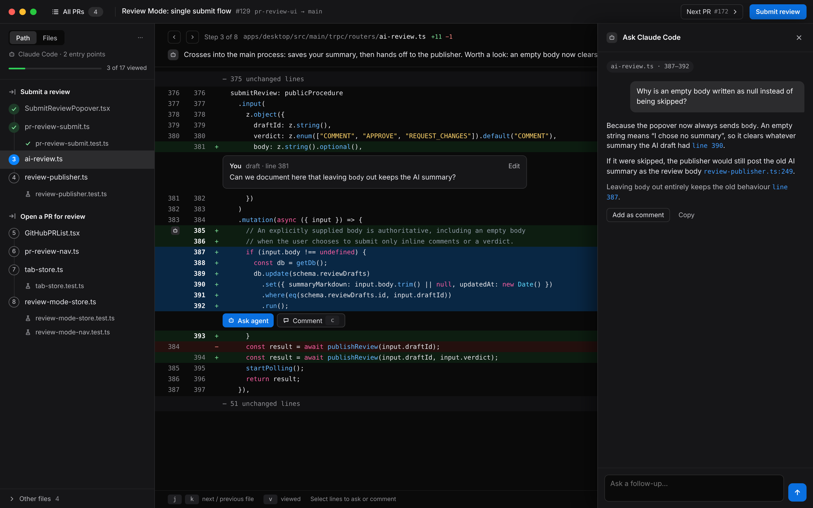
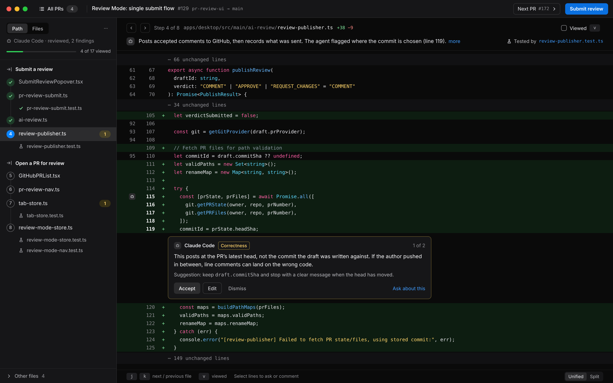
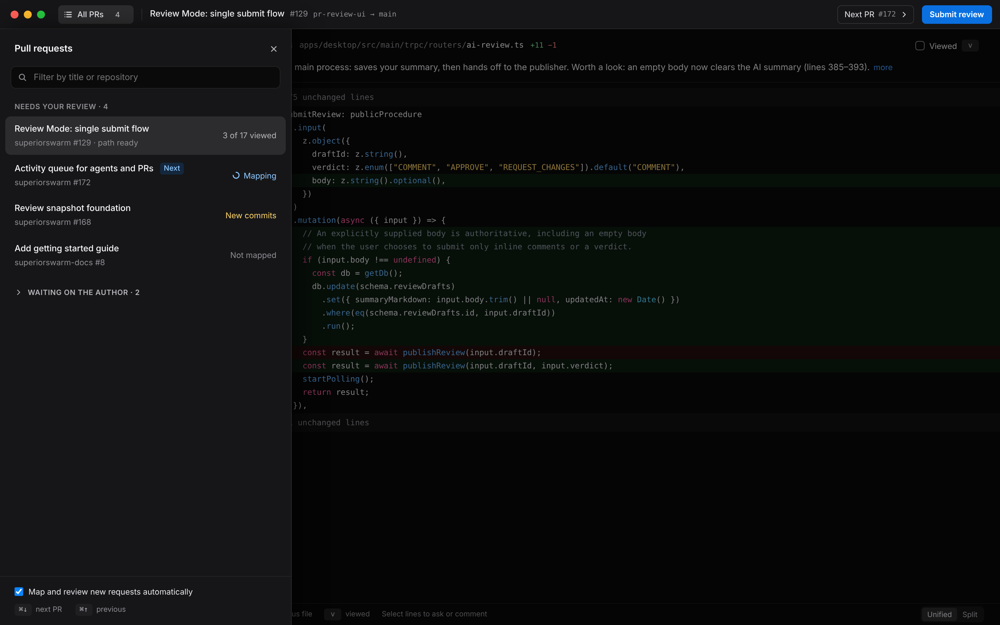
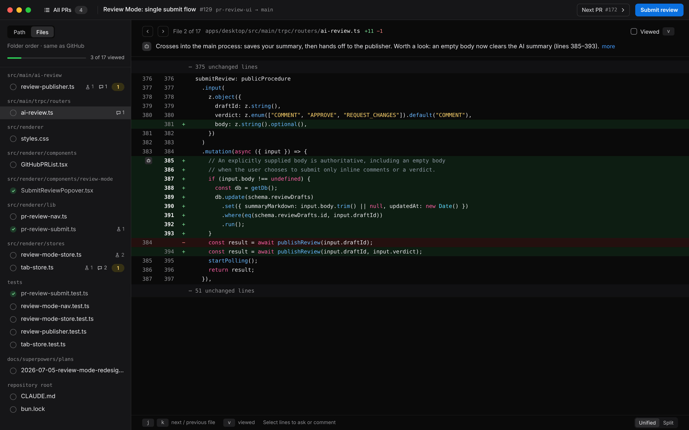
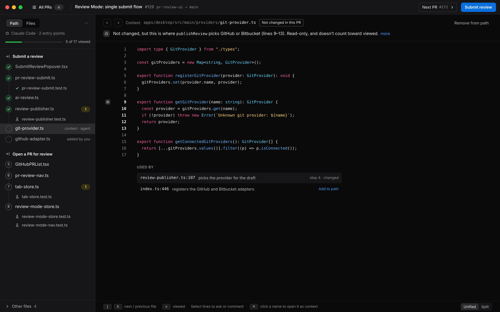
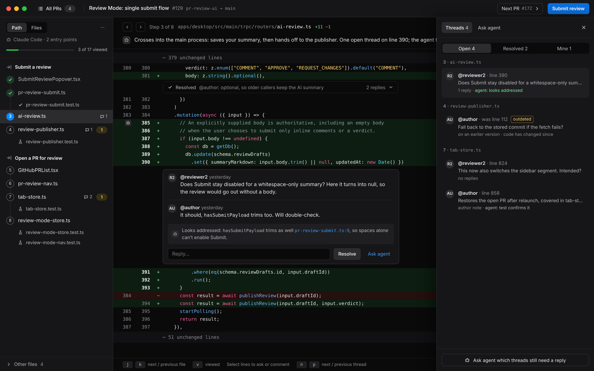

# Agent Reading Path for PR Review — Design Spec

> **Implementation clarification (2026-11-21):** The user confirmed this replaces the current PR review workflow. `ReviewWorkspace` is the default review entry point, not a preference-gated preview. References below to the preview flag/flag-off acceptance describe the original rollout proposal and are superseded. Existing submit, draft, reply, resolve, and terminal behavior must carry over. Path mapping and Ask remain frontend-only in this increment: fixtures require explicit opt-in, and live PRs must clearly report that those backends are unavailable rather than display sample agent output.

**Date:** 2026-11-21
**Status:** Approved by Thomas for frontend implementation
**Scope:** Frontend only (renderer + shared types + fixtures). The MCP tools and persistence that produce a path are a later backend increment; this spec fixes the contract they must satisfy.
**Visual mocks:** `docs/superpowers/specs/assets/2026-11-21-agent-reading-path/` — one PNG (2×) and one standalone HTML per screen, all at 1512×945. Live canvas: https://claude.ai/artifact/Rpnes8HKKwGj7XsfXDBvyx
**Implementation plan:** `docs/superpowers/plans/2026-11-21-agent-reading-path.md`
**Related:** `docs/superpowers/specs/2026-07-05-review-mode-redesign-design.md` (current Review Mode), `.hermes/plans/2026-11-10_18-55-explainable-pr-review-investigation.md` (earlier investigation; this spec replaces its deterministic-flow UI with an agent-authored path, but keeps its rules on honesty, coverage and progress).

---

## 1. Problem

Reviewers get automated findings but still don't understand the PR, because files are listed in provider/alphabetical order. They want to read a PR the way the code runs: from an entry point, through what it calls, to the tests that cover it. They also want to ask questions, see other people's comments and the agent's findings without losing their place, and move to the next PR quickly. The previous design attempt was rejected as too busy; this one is deliberately calm.

## 2. Goals

1. The user's agent maps the PR through our MCP into a **reading path**: ordered steps, grouped by entry point. Several entry points are normal.
2. **Files stay the source of truth.** A step is a file shown as its normal diff. The agent only adds order, one sentence, focus lines and test links.
3. Every test is shown **under the code it covers**.
4. The agent can **review** the code; findings appear inline and can be accepted, edited or dismissed.
5. The user can **ask** the agent about selected lines and **comment** inline; other reviewers' threads are visible and answerable.
6. The user can pull in **context** (unchanged files) when a flow needs it.
7. A **Files** view exists for when no path is wanted.
8. The whole review fits a **14-inch MacBook Pro** window (1512×945) without feeling cramped. All PRs and Next PR are always one click away.

**Non-goals (this increment):** building the MCP tools, persisting paths in SQLite, real agent conversation transport, revision-pinned snapshot reads, changing the submit flow, redesigning the app sidebar (being reworked elsewhere).

## 3. Decisions (confirmed with Thomas)

| Topic | Decision |
|---|---|
| Step unit | File + focus lines + one-line note (optional "more" paragraph). A file appears in the path once; if it serves two entry points it shows an "also used in …" note. |
| Layout | Two columns: path rail (left) + diff (rest). Ask/Threads open as a 400px overlay panel on the right only when needed. |
| App sidebar | Not shown during review. Top bar has **All PRs** (drawer) and **Next PR**. |
| Entry points | One rail, one section per entry point. |
| Tests | Nested under the step they cover; also linked from the step header ("Tested by …"). |
| Path creation | Manual ("Map this PR") and automatic when the user is requested as reviewer (setting). Steps appear live while mapping. |
| Agent explanation | One sentence above the diff + "more" link. |
| Files the agent left out | Collapsed "Other files" section at the bottom of the rail. Nothing is hidden. |
| Agent findings | Inline cards on their lines + a yellow count on the step in the rail. |
| Ask / comment | Select lines → **Ask agent** or **Comment**. Comments are inline threads; the conversation lives in the side panel. |
| Other people's comments | Inline threads (resolved collapsed to one line), grey count per step, **Threads** tab in the panel. Outdated threads are listed, never moved onto new lines. Agent may add a "looks addressed" note. |
| No path wanted | **Path \| Files** switch in the rail header. Files = folder order like GitHub. Unmapped PRs open in Files. |
| More context | Unchanged files can be **context steps** (dotted marker, read-only, not counted as viewed). Added by the agent via MCP, or by the user (⌘-click a name, "Add to path"). |
| Active row style | Raised background only. **No blue left-edge bars** (remove the existing one in `FileSection.tsx` when this layout replaces it). |
| Focus lines | Bright, semibold line numbers + small agent glyph in the gutter on the first focused line. No coloured side bar. |

## 4. Layout



| Region | Size | Notes |
|---|---|---|
| Top bar | 44px tall, full width | `--bg-surface`, bottom border `--border-subtle`. macOS traffic lights live inside it (hidden-inset title bar). |
| Path rail | 288px default, resizable 240–360 (reuse the existing navigator resize logic in `ReviewModeShell.tsx`) | `--bg-surface`, right border. Collapsible with ⌘. (existing `toggle-navigator`). |
| Step header | auto (≈80px) | Two rows: navigation + file + Viewed; agent note. |
| Diff | fills remaining space | Existing Monaco `DiffEditor`, unified by default. |
| Hint bar | 32px | Keyboard hints left, Unified/Split right. |
| Side panel | 400px overlay, right edge, full body height | Only when Threads or Ask is open. Does not reflow the diff. |
| All PRs drawer | 440px overlay from the left, with a 45% black scrim over the rest | |

At 1512×945 the diff shows ~37 lines at 12px/20px. Nothing may scroll horizontally except code lines.

## 5. Screens

Each screen below links its mock. Mocks use example PR #129 (Review Mode submit flow) with real code from this repo; diff +/− markers, findings, reviewer handles and agent text are illustrative.

### 5.1 Open a PR, no path yet — `01-start-no-path.png`



- Rail header: "Files", "17 changed · alphabetical", progress.
- **Map card** at the top of the rail: title "No reading path yet", one sentence, primary **Map this PR**, agent picker (defaults to the user's configured review agent), checkbox **Also review the code** (default on), divider, checkbox **Do this automatically when I'm asked to review a PR**.
- Below: plain file list (filename + muted folder).
- Main area: PR overview (title, number, branch, author, file count, checks, description). Hint: "j opens the first file."
- The same overview is shown when the user clicks the PR title in the top bar on any screen.

### 5.2 Agent maps the PR, live — `02-mapping-live.png`



- Top bar status slot: pill "Mapping · 8 of 17 placed" (spinner). Clicking it opens the agent's terminal drawer (existing `TerminalDrawer`).
- Rail header: Path|Files switch, "Claude Code is reading `tab-store.ts`", **Stop** button.
- Steps appear as the agent places them; the next one or two slots show skeleton rows. A collapsed "Not placed yet · 9" section replaces "Other files" while mapping.
- The user can already read placed steps. New steps never move the user's current position or focus.
- Step label shows "Step 1" (no total) while mapping.

### 5.3 Reading a step — `03-reading-step.png`

- Step header row 1: ‹ › buttons, "Step 3 of 8", path (folder muted, filename bright), +/− stats, **Viewed** checkbox with `v` hint.
- Row 2: agent glyph + one sentence; "more" expands the agent's optional paragraph inline under the sentence (max ~4 lines).
- Diff: unchanged regions folded ("⋯ 375 unchanged lines"). Focus lines: bright semibold line numbers; the first focus line shows the agent glyph in the old-line gutter (Monaco decoration).
- Rail: current step row has the raised background (`--bg-overlay`) and a filled accent number; viewed steps show a green check; tests indented under their step with a flask icon (check when viewed).

### 5.4 Ask and comment — `04-ask-and-comment.png`



- Selecting lines highlights them (`--accent-subtle`) and shows an inline action row right under the selection: **Ask agent** (primary) and **Comment** (`c`).
- **Comment** opens the existing inline composer (current `pendingLine` / `addUserComment` flow). Saved drafts render as inline cards ("You · draft · line 381").
- **Ask agent** opens the side panel on the Ask tab with a context chip (`ai-review.ts · 387–392`), the question, and the agent's answer. Line references in the answer are links that move the diff (same file) or open the step/context file.
- Under each answer: **Add as comment** (prefills the composer on the anchored lines) and **Copy**.
- Composer at the bottom: "Ask a follow-up…".

### 5.5 Agent findings — `05-agent-findings.png`



- Findings are the existing AI draft comments (`AIDraftThread`). Rendered as an inline card on their line: agent glyph, "Claude Code", optional category tag (yellow outline), "1 of 2", body, optional suggestion, **Accept** / **Edit** / **Dismiss**, **Ask about this**.
- Rail: yellow count badge on steps with untriaged findings (`status === "pending"`).
- Rail header line: "Claude Code · reviewed, 2 findings".
- Step header right side: "Tested by `review-publisher.test.ts`" link when the step has tests.

### 5.6 All PRs and next PR — `06-all-prs-next-pr.png`



- **All PRs** (top bar, with count) opens a left drawer: title, filter input, section "Needs your review · N" (current PR highlighted with raised background; next PR has a "Next" tag), collapsed "Waiting on the author · N". Each row: title, repo + number, status on the right: viewed progress / "Mapping" / "New commits" / "Not mapped".
- PRs the user authored are not listed (Thomas: "don't need to see the PRs I'm the author of here").
- Footer: checkbox **Map and review new requests automatically** (same setting as 5.1), shortcuts ⌘↓ next PR, ⌘↑ previous.
- **Next PR** button in the top bar shows the next PR's number; it opens that PR through the same flow as the sidebar (review workspace creation included).

### 5.7 Files view (no path needed) — `07-files-view.png`



- Rail header switch set to **Files**. Folder groups in provider/GitHub order (compact folder labels), files under each. j/k walks this order.
- Each file row: viewed marker, name, then (if any) flask + test count, grey thread count, yellow finding count.
- The step header reads "File 2 of 17"; the agent note still shows if the PR was mapped.
- The choice persists per user (default: Path when a path exists, otherwise Files). `f` toggles.

### 5.8 More context — `08-context-files.png`



- Context steps sit inside an entry after the step they explain. Marker: dotted circle, no number. Right label: "context · agent" or "added by you".
- Opening one shows a **read-only** full file (no diff colours), header label "Context", tag "Not changed in this PR", **Remove from path**, agent sentence (if agent-added), focus lines as usual.
- Below the code: **Used by** list (call sites, from the agent or a reference search): `path:line`, short description, "step N · changed" or **Add to path**.
- ⌘-click on an identifier in any diff or context file opens its definition as a context file; the header then offers **Add to path**. Hint bar shows "⌘ click a name to open it as context".
- Context steps never count toward "viewed".

### 5.9 Comments from other reviewers — `09-comments-from-others.png`



- Inline: unresolved threads expanded (messages, optional agent note row, Reply input, **Resolve**, **Ask agent**). Resolved threads collapse to a one-line button ("✓ Resolved · @author: … · 2 replies").
- Agent note row inside a thread (optional): "Looks addressed: … `pr-review-submit.ts:9`". Never posted anywhere; it's a local hint.
- Rail: grey speech-bubble count of **open** threads per step (separate from the yellow findings count).
- Panel **Threads** tab: filter Open / Resolved / Mine, grouped by step ("3 · ai-review.ts"); each row shows author, line, one-line excerpt, replies count, agent verdict. Outdated threads show "was line 112" + "outdated" tag and "on an earlier version · code has changed since". Clicking a row jumps to the thread (or to the file header for outdated ones).
- Footer action: **Ask agent which threads still need a reply**.
- `n` / `p` move between threads in the current file (existing keys).

## 6. Component inventory

New components live under `apps/desktop/src/renderer/components/review-mode/` unless noted. Reuse before you build.

| Component | Purpose | Reuses |
|---|---|---|
| `ReviewWorkspace.tsx` | New shell (top bar, rail, main, overlays). Rendered instead of `ActiveReviewModeShell` when the `reviewPathLayout` flag is on. | data hooks + callbacks from `ReviewModeShell.tsx` (extract into a hook) |
| `top-bar/ReviewTopBar.tsx` | All PRs button, PR title (opens overview), status slot, Next PR, Submit | `SubmitReviewPopover`, `AgentStatusChip` |
| `top-bar/MappingPill.tsx` | "Mapping · x of y placed" | — |
| `rail/ReviewRail.tsx` | Rail container + resize | navigator resize from `ReviewModeShell` |
| `rail/RailHeader.tsx` | Path\|Files switch, agent line, progress, ⋯ / Stop | — |
| `rail/MapPathCard.tsx` | Unmapped call-to-action + settings checkboxes | — |
| `rail/PathRail.tsx` | Entry sections, step/test/context/skeleton rows, Other files / Not placed yet | — |
| `rail/StepRow.tsx`, `TestRow.tsx`, `ContextRow.tsx`, `SkeletonRow.tsx` | Row variants (see §8 visual rules) | — |
| `rail/FilesRail.tsx` | Folder-grouped file list | viewed state from `trpc.github.getViewedFiles` |
| `step/StepHeader.tsx` | Nav, label, path, stats, Viewed, agent note + more, tests link | viewed toggle logic from `ChangesView` |
| `step/ContextFileView.tsx` | Read-only file view + Used by | `trpc.diff.getFileContent` |
| `hooks/useFocusDecorations.ts` | Monaco decorations for focus ranges | pattern of `useThreadDecorations.ts` |
| `hooks/useSelectionActions.ts` | Inline Ask/Comment row under a selection | `useInlineCommentZones.tsx` (view zones) |
| `panel/SidePanel.tsx` | 400px overlay, tabs Threads \| Ask agent | — |
| `panel/ThreadsTab.tsx` | Filtered, grouped thread list | `pr-review-threads.ts` helpers |
| `panel/AskTab.tsx` | Conversation, citations, Add as comment, composer | `ReplyComposer` styles |
| `thread/FindingCard.tsx` | Agent finding variant | `ThreadActions` callbacks (`onAccept`, `onDecline`, `onSaveEdit`) |
| `thread/ResolvedThreadRow.tsx`, `thread/AgentNoteRow.tsx` | Collapsed resolved thread; agent hint inside a thread | `ThreadCard` |
| `queue/AllPRsDrawer.tsx` | PR queue drawer | PR queries used by `PullRequestsTab.tsx` |
| `HintBar.tsx` | Keyboard hints + Unified/Split | — |
| `views/OverviewView.tsx` | Existing; shown for unmapped PRs and when the title is clicked | as-is |

Non-component modules: `src/shared/review-path-types.ts`, `src/renderer/lib/review-path-model.ts`, `src/renderer/lib/review-path-source.ts`, `src/renderer/lib/review-path-fixtures.ts`, `src/renderer/lib/review-queue.ts`, `src/renderer/lib/open-pr-review.ts`.

## 7. Interaction and keyboard

| Key | Action | Status |
|---|---|---|
| `j` / `k` | Next / previous item in rail order (Path: step → its tests → its context steps → next step → … → other files; Files: tree order) | existing key, new order |
| `v` | Toggle viewed on the current changed file | existing |
| `c` | Comment on selection / current line | existing |
| `n` / `p` | Next / previous thread in file | existing |
| `f` | Toggle Path / Files | new |
| `/` | Ask agent (uses the selection if any, otherwise the current step) | new |
| `t` | Open panel on Threads | new |
| `⌘↓` / `⌘↑` | Next / previous PR in the queue | new (mapper currently ignores all ⌘ keys except ⌘.) |
| `⌘.` | Collapse rail | existing |
| `⌘`-click identifier | Open definition as context file | new |
| `Esc` | Close the deepest layer first: composer → panel → drawer → overview → (existing) leave Review Mode | existing, extended |
| `1` `2` `3` | Retired in the new layout (no view switcher). Keep them working in the old shell. | — |

Rules:
- Switching items reuses one Monaco instance (model swap), as `ChangesView` already does. Show a skeleton, never stale content under a new filename. Item switch must feel instant (< 100 ms for cached files).
- Live path updates never steal focus or move the current item; if the current file is placed into a different position, keep it selected.
- Opening a file, scrolling, asking, or accepting a finding never marks anything viewed. Only `v` / the Viewed checkbox does.
- The panel and drawer are overlays: opening them never re-lays out the diff.

## 8. Visual rules and tokens

Use only the CSS variables in `apps/desktop/src/renderer/styles.css` (light theme follows automatically). The mocks were drawn with the dark values below.

| Mock value | Token | Used for |
|---|---|---|
| `#0a0a0a` | `--bg-base` | diff background, inputs |
| `#161618` | `--bg-surface` | top bar, rail, panel, drawer, cards on base |
| `#1f1f22` | `--bg-elevated` | cards inside rail/panel, map card |
| `#2c2c2e` | `--bg-overlay` | **active row**, active segment, agent glyph bg, kbd bg on surface |
| `rgba(255,255,255,.06/.08)` | `--border-subtle` | dividers |
| `rgba(255,255,255,.1–.12)` | `--border` | buttons, cards |
| `rgba(255,255,255,.16)` | `--border-active` | secondary buttons, composer |
| `#f5f5f7` / `#e5e5ea` | `--text` | primary text, code |
| `#b5b5ba` | `--text-secondary` | secondary text, rail rows (viewed), test rows |
| `#8e8e93` | `--text-tertiary` | labels, line numbers, meta. **Never** `--text-quaternary` for text (fails contrast). |
| `#0a84ff` | `--accent` | current step number, primary buttons (the mocks used a darker `#0a70e0` on buttons for contrast; implementation keeps `--accent` like the rest of Review Mode), selection tint via `--accent-subtle`, links `--accent-hover` |
| `#30d158` / green check | `--color-success`, `--success-subtle` | viewed markers, progress bar |
| yellow badge / outline | `--tag-amber-fg/-bg/-border` | finding counts, finding card border, "outdated", "new commits" |
| grey outline tag | `--tag-gray-fg/-border` | "Not changed in this PR", "context" |

Type ramp: 14/600 drawer title, 13 body and row labels, 12 secondary, 11 floor (labels, kbd, meta). Mono (`--font-mono`) for paths, line refs and code only. Radii: 6 (buttons), 8 (cards, rows in panel), 10 (map card). Motion: 120ms fades (`--transition-fast`), no slides.

Row specs (rail):
- Step row: 34px, padding 0 14 0 16, gap 10. Marker 20×20 circle: todo = 1.5px `--text-quaternary` ring + number; current = `--accent` fill + white number; viewed = `--success-subtle` fill + green check. Filename 13px, ellipsis. Right side: grey thread count, then yellow finding count.
- Test row: 26px, indent 46px, 12px, flask icon (check when viewed).
- Context row: 32px, dotted 1.5px ring, no number, right label 11px.
- Skeleton row: dashed ring + 8px tall bar.
- A 1px `--bg-overlay` vertical line connects markers within an entry (decorative).
- **No inset/left-border accent on any row.**

Accessibility: real `<button>`/`<a>`/`<input>` elements; `aria-current="step"` on the current rail item; `aria-pressed` on toggles; icon-only buttons get `aria-label`; markers carry `aria-label` ("Viewed", "Context, not changed"); colour is never the only signal (counts have icons, states have shapes/labels). Focus rings use `--accent`.

## 9. Data contract (shared types)

New file `apps/desktop/src/shared/review-path-types.ts`. The FE builds against these types with fixtures; the backend/MCP increment must produce exactly this shape.

```ts
export type ReviewPathStatus = "none" | "mapping" | "ready" | "failed" | "stale";

export interface ReviewPath {
	id: string;
	prKey: string; // formatPrIdentifier(prCtx)
	headSha: string; // PR head the path was built for; differs from details.headCommitOid => "stale"
	agent: { id: string; label: string }; // e.g. { id: "claude-code", label: "Claude Code" }
	status: ReviewPathStatus;
	progress?: { placed: number; total: number; currentFile?: string }; // while mapping
	reviewed?: { findings: number }; // set when the agent also reviewed
	entries: ReviewPathEntry[];
	otherFiles: string[]; // changed files the agent did not place
	threadNotes?: Record<string, AgentThreadNote>; // keyed by thread id
	error?: string; // when status === "failed"
	updatedAt: string; // ISO
}

export interface ReviewPathEntry {
	id: string;
	title: string; // short, e.g. "Submit a review"
	steps: ReviewPathStep[];
}

export type ReviewPathStep = ChangedFileStep | ContextFileStep;

interface ReviewPathStepBase {
	id: string;
	path: string; // repo-relative
	note: string; // one sentence
	detail?: string; // optional paragraph behind "more" (markdown, no images)
	focus: FocusRange[];
	alsoIn?: string[]; // other entry ids this file serves
}

export interface ChangedFileStep extends ReviewPathStepBase {
	kind: "changed";
	tests: StepTest[];
}

export interface ContextFileStep extends ReviewPathStepBase {
	kind: "context";
	addedBy: "agent" | "user";
	usedBy?: CodeReference[];
}

export interface StepTest {
	path: string;
	changed: boolean; // unchanged tests open as read-only context
}

export interface FocusRange {
	side: "LEFT" | "RIGHT";
	startLine: number;
	endLine: number;
}

export interface CodeReference {
	path: string;
	line: number;
	description: string;
}

export interface AgentThreadNote {
	verdict: "addressed" | "open" | "unclear";
	text: string;
	refs?: CodeReference[];
}

export interface AskMessage {
	id: string;
	role: "user" | "agent";
	text: string; // markdown
	anchor?: { path: string; side: "LEFT" | "RIGHT"; startLine: number; endLine: number };
	refs?: CodeReference[];
	createdAt: string;
}

export interface ReviewPathSettings {
	autoMapOnReviewRequest: boolean;
	alsoReview: boolean;
	defaultRailMode: "path" | "files" | "auto"; // auto = path when one exists
}
```

Additive, optional fields on existing types (FE must handle absence):
- `GitHubReviewThread.isOutdated?: boolean` and `originalLine?: number | null` (GitHub GraphQL exposes both).
- `AIDraftThread.category?: string` (finding tag such as "Correctness").

Derived rules (implemented in `review-path-model.ts`, unit tested):
- **Coverage:** every file in `details.files` appears exactly once as a changed step, a step test (`changed: true`) or in `otherFiles`. Missing files are appended to Other files at render time and logged in dev.
- **Numbering:** changed steps are numbered 1…N across entries in order; context steps and tests are unnumbered.
- **Progress:** viewed count = viewed changed files ÷ `details.files.length`. Context and unchanged tests never count.
- **Stale:** `path.headSha !== details.headCommitOid` → show the path with a quiet "Path is from an older commit · Re-map" line under the rail header. Steps whose file no longer changes move to Other files.

## 10. States and edge cases

| State | Behaviour |
|---|---|
| No path | 5.1. Files view in the rail, overview in main. |
| Mapping | 5.2. Stop cancels the agent run (existing cancel). |
| Failed | Rail header line "Mapping failed · Retry"; rail falls back to Files. |
| Stale | See §9. Never silently reorder. |
| Closed/merged PR | Read-only (existing banner). Map/Ask still allowed; comment/accept disabled. |
| Bitbucket | Same UI. Viewed toggle hidden where unsupported (existing gating). |
| Large PR (>100 files) | Rail virtualised; Other files collapsed with count. |
| File missing / binary | Step header shows the file; body shows the existing binary/unavailable message. |
| Agent offline | Map button disabled with reason; Ask composer disabled with "Agent not running · Start". |

## 11. Out of scope / follow-ups

1. MCP tools for the path (`set_review_path`, `add_path_step`, `add_context_step`, `set_thread_note`, `answer_question`) and SQLite persistence. Must emit `ReviewPath` as defined in §9.
2. Auto-map trigger: extend `main/ai-review/auto-trigger.ts` with `autoMapOnReviewRequest`.
3. Real Ask transport (agent session ↔ panel).
4. Snapshot-pinned reads for context files (`reviewExplanation` router) instead of branch reads.
5. Reference search for "Used by" when the agent didn't supply it (LSP `references`).

## 12. Open questions (do not block the FE)

1. Should Next PR skip PRs whose path is still mapping?
2. Should "Add as comment" from an Ask answer include the agent's citations as links?
3. Keep the old Overview/Comments views reachable behind a menu for one release, or remove them when the flag defaults on?
